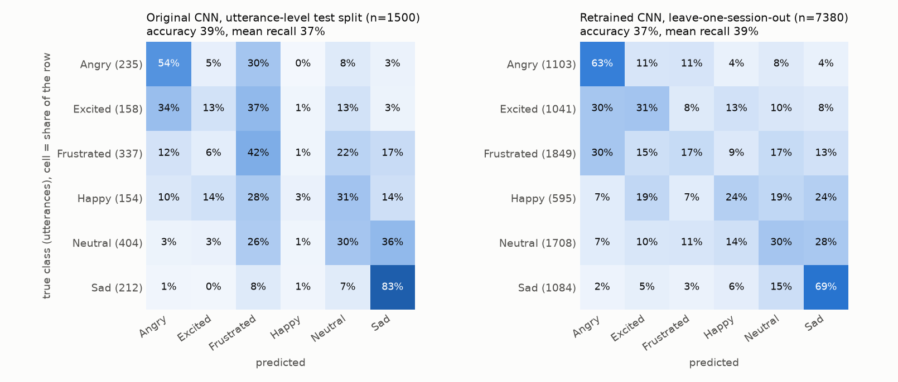
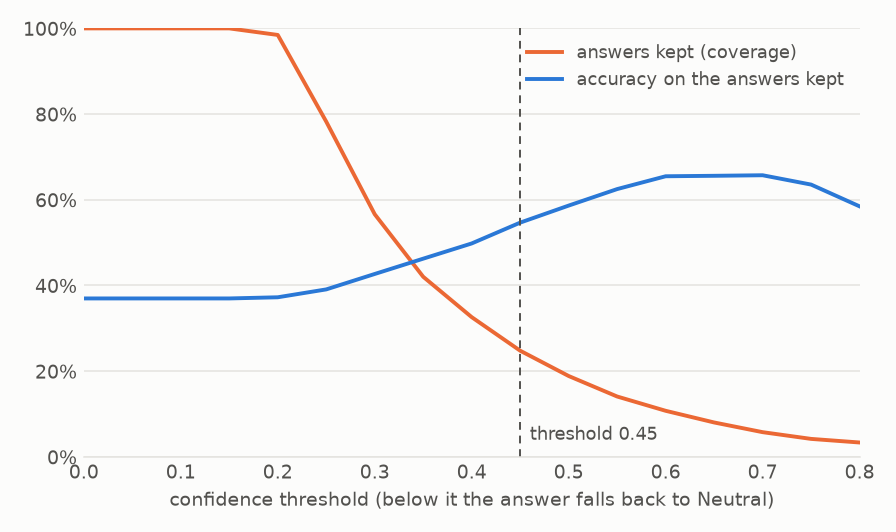

# EmotionLLM

Speak into a microphone: a CNN on MFCCs guesses the emotion of your voice, Whisper transcribes what you said, and a
small language model answers in a tone adapted to that emotion (angry → calm, sad → empathetic, frustrated →
reassuring...). Built for a CentraleSupélec course project (ST7, March 2025), reworked in October 2026.

**No hosted demo for now.** The app runs locally (see [Run it](#run-it)); a turn takes 7 to 12 seconds on 2 CPU
threads. Creating a Gradio Space on a free Hugging Face account returned *402 Payment Required* in October 2026, so the
Space files are ready (`scripts/deploy_space.py`) but not deployed.

The emotion model is weak: on speakers it has never heard it gets **37% of six classes right (chance: 17%)**. Treat the
label as a hint, and read [Results](#results) and [Limits](#limits) before drawing conclusions.

## Pipeline

```
microphone / file ─► 16 kHz mono ─► voice activity detection ─► RMS normalisation ─► 8 s sliding windows
                                                                                          │
                              ┌───────────────────────────────────────────────────────────┘
                              ▼
                  13 MFCCs × 500 frames ─► CNN ─► probabilities per window ─► average ─► confidence ≥ threshold ?
                                                                                       yes: emotion   no: Neutral
audio ─► Whisper (local, CPU) ─► transcript ─┐
                                              ├─► Qwen2.5-1.5B-Instruct (GGUF, CPU) ─► reply in the chosen tone
emotion ─► tone instruction in the prompt ───┘
```

1. **Preprocessing** (`emotionllm/audio.py`, `preprocess.py`): any sample rate to 16 kHz mono, energy-based voice
   activity detection (leading and trailing silence cut, pauses longer than 0.5 s shortened), speech RMS normalised to
   −26 dBFS, windows of 8 s every 4 s for long recordings.
2. **Features** (`features.py`): the 13 MFCCs the network was trained on, computed with numpy only. The output matches
   `librosa.feature.mfcc` to 1e-3 (checked in the tests), so librosa and numba are not needed at runtime.
3. **Classifier** (`model.py`, `inference.py`): the CNN of the original project (three 3×3 convolutions with max-pooling,
   two dense layers, 532,102 parameters, input 13 × 500). It returns six probabilities per window, averaged over the
   windows. When the top probability is below a threshold the answer is **Neutral**, whose tone instruction is empty.
4. **Transcription** (`asr.py`): [faster-whisper](https://github.com/SYSTRAN/faster-whisper) `base`, int8 on CPU, language
   detected automatically. It replaces the Google Web Speech API of the first version, so nothing leaves the machine.
5. **Reply** (`llm.py`, `prompt.py`): the emotion becomes a short instruction in the system prompt. By default a
   quantised [Qwen2.5-1.5B-Instruct](https://huggingface.co/Qwen/Qwen2.5-1.5B-Instruct-GGUF) (Apache-2.0) runs through
   llama.cpp on the CPU. Other backends: the Hugging Face inference API (`EMOTIONLLM_BACKEND=hf-api`, needs `HF_TOKEN`)
   and the original Llama 3 8B Instruct with `transformers` (`EMOTIONLLM_BACKEND=llama3-8b`, needs a GPU and access to
   the gated model; this path is kept for the desktop app and is not exercised by the tests).

## Results

Data: [IEMOCAP](https://sail.usc.edu/iemocap/), 7,380 acted utterances, 10 speakers in 5 sessions, six classes
(angry, excited, frustrated, happy, neutral, sad). The classes are unbalanced: frustrated is the most frequent at 25%,
happy the rarest at 8%. IEMOCAP is distributed under a license agreement with USC and is **not** included here.

### The model that was in the repository did not work

| Model | Test data | Accuracy | Mean recall | Remark |
|---|---|---:|---:|---|
| `emotion_classification_model_weight_3.pth`, as shipped (a Transformer, see below) | 1,500 utterances | 26.9% | 16.7% | predicts *Neutral* for every input |
| `weight_2` CNN, original split | first 512 of the test file (the notebook's numbers) | 39.7% | 40.1% | reproduced exactly: 39.65% |
| same CNN | all 1,500 test utterances | 39.3% | 37.4% | *happy* predicted 18 times out of 1,500 |
| same CNN | its own training data (5,120) | 71.5% | 67.3% | reproduced exactly: 71.50% |

* The weight file named in the original `README.md` and loaded by `model.py` is **not** the CNN. It is a Transformer
  (`emo_cla_3.ipynb`: embedding 13→128 and `nn.Transformer`), trained for **one epoch on 512 utterances**: its loss
  ended at 1.58, close to the 1.79 of a random guess, and it outputs the same probabilities whatever the input.
* `model.py` loaded it with `strict=False`, so none of its keys matched, nothing was loaded and the CNN ran with
  random weights. **In the first version the emotion label was effectively random.** Both original weight files are
  kept in `weights/original/`, and `tests/test_shipped_weights.py` checks that a weight file loads strictly.
* The CNN of the notebook overfits (71.5% on its training data, 39.3% on test), and its split is by utterance: the same
  speakers, dialogues and microphones appear on both sides, so even the 39% is optimistic for a new speaker.

### Retrained CNN, speaker-independent

Same architecture, new recipe (`scripts/train_cnn.py`), evaluated with **leave-one-session-out**: train on four
sessions (one of them for early stopping), test on the fifth, and rotate. No test speaker is ever seen in training.
The recipe: preprocessing above, per-coefficient MFCC standardisation, class-weighted loss with label smoothing,
AdamW, early stopping, and light augmentation (speed ±10%, white noise at 10–25 dB, time shifts, time and frequency
masking).

| | Accuracy | Mean recall | Macro-F1 |
|---|---:|---:|---:|
| Retrained CNN, 5 held-out sessions pooled (7,380 utterances) | 37.0% | 38.9% | 35.2% |
| per session, mean ± std of the mean recall | | 37.9% ± 2.5 | |
| per session | | 41.5 / 38.1 / 37.0 / 33.7 / 39.0 | |
| chance / always *frustrated* | 16.7% / 25.1% | 16.7% | |

The same network trained with the original recipe (raw MFCCs, no silence removal, no normalisation, first 16 s,
plain cross-entropy, no augmentation) under the same protocol, to see what the new recipe changes:

| | Accuracy | Mean recall | Macro-F1 | Mean recall per session |
|---|---:|---:|---:|---|
| Original recipe, leave-one-session-out | 38.3% | 34.9% | 33.2% | 37.1% / 37.9% / 31.3% / 35.6% / 34.4% |
| New recipe (the shipped model) | 37.0% | 38.9% | 35.2% | 41.5% / 38.1% / 37.0% / 33.7% / 39.0% |

The new recipe gains 4 points of mean recall and 2 of macro-F1 and loses 1 point of plain
accuracy (the class-weighted loss gives up some of the frequent classes for the rare ones). The gain is modest and not
uniform: the original recipe does better on session 4. What the new recipe mainly buys is robustness to recording level and to silences,
which this benchmark cannot show: IEMOCAP is clean and consistently recorded.



Per-class recall on unseen speakers: sad 69%, angry 63%, excited 31%, neutral 30%, happy 24%, frustrated 17%. The two
extremes in arousal are recognised; the middle of the circumplex (frustrated, neutral, happy, excited) is mostly
confused with its neighbours. Frustrated is the most frequent class and the least recognised.

### Fallback to Neutral

The probabilities are calibrated by temperature scaling (T = 1.27, fitted on the held-out predictions; expected
calibration error 7.5% → 4.9%). The tone of the reply only changes when the top probability is at least **0.45**, the
smallest threshold at which the emotions the model commits to are right at least half of the time. At that threshold
the model commits for 25% of the utterances and is right 55% of the time on them; the rest of the answers stay neutral.



The threshold is a slider in the demo, so you can watch the trade-off. The temperature and the threshold were fitted on
the same held-out predictions that the table reports, so the figures of this paragraph are slightly optimistic.

## Limits

* **37% on six classes is low.** An MFCC CNN trained on a small acted corpus is a toy next to pretrained speech models
  (wav2vec 2.0, emotion2vec), which would be the natural next step. They were not run here, so there is no comparison.
* **Acted speech.** IEMOCAP actors play scripted or improvised scenes in a studio, in English. Spontaneous speech, other
  languages, laptop microphones and background noise are out of distribution. The augmentation and the normalisation
  help in principle; this was not measured on real recordings.
* **Confidence out of domain.** Four text-to-speech clips (flat synthetic voices: an angry, a neutral and a sad
  sentence, and a neutral one in French) were labelled *angry* three times with probabilities of 0.53 to 0.66, above
  the fallback threshold; the angry sentence came out *frustrated* (0.58). The probabilities are calibrated on IEMOCAP
  only and say nothing about other kinds of audio. The app has not been tested on real recordings yet.
* **Labels are subjective**: IEMOCAP annotators disagree with each other, which caps what any model can reach.
* **The language model does not hear the audio.** It receives the transcript and one tone instruction. A 1.5 billion
  parameter model follows the tone loosely and sometimes answers in the wrong style; Llama 3 8B of the first version
  would do better but does not fit on a free CPU.
* **CPU only.** One request at a time; on 2 threads an answer takes 7 to 12 seconds and recordings are cut at 30 seconds.
  The app does not store recordings (Gradio's temporary files are purged every hour).
* The voice activity detector is an energy threshold: it is fine for a quiet room, not for noisy speech.

## Run it

```bash
pip install -r requirements.txt
python app.py                 # Gradio on http://127.0.0.1:7860; models are downloaded on first run (about 1.3 GB)
```

`desktop_app.py` is the original Tkinter window (microphone through PyAudio) on top of the same package.
Tests and linting:

```bash
pip install -r requirements-dev.txt
pytest                        # 60 tests, no model download, no GPU
ruff check .
```

## Reproduce the numbers

You need IEMOCAP (request it from USC) in the form of the pickles of the original notebooks, or adapt
`scripts/prepare_iemocap.py` to the raw release. The data stays out of git.

```bash
python scripts/prepare_iemocap.py data/train_set.pkl data/test_set.pkl --out data/iemocap.npz   # restricted unpickler
python scripts/evaluate_original.py data/iemocap.npz \
    --cnn weights/original/emotion_classification_model_weight_2.pth \
    --transformer weights/original/emotion_classification_model_weight_3.pth
python scripts/train_cnn.py data/iemocap.npz --variant robust --out results/cnn_robust.json --export weights/emotion_cnn.pth
python scripts/train_cnn.py data/iemocap.npz --variant legacy --out results/cnn_legacy.json
python scripts/make_figures.py
```

`results/` holds the JSON reports behind the tables (confusion matrices, per-session scores, selective-answer curve).
`weights/emotion_cnn.pth` carries the network, the MFCC statistics, the preprocessing recipe, the temperature and the
threshold, so the classifier is rebuilt exactly as it was trained.

## Hugging Face Space (ready, not deployed)

`python scripts/deploy_space.py --stage build/space` assembles the Space (code, weights, `space/README.md` as its
README); `--push USER/SPACE` uploads it with the token saved by `hf auth login` (or `HF_TOKEN`). No secret is needed
at run time: the language model and Whisper are public and downloaded by the Space itself.

## Layout

| Path | Role |
|---|---|
| `app.py` | Gradio interface (the Space) |
| `desktop_app.py` | Tkinter interface of the original project |
| `emotionllm/` | features, audio, preprocessing, CNN and checkpoint, inference, prompts, ASR, LLM backends, evaluation metrics |
| `scripts/` | data preparation, evaluation of the original models, training, figures, Space deployment |
| `weights/` | `emotion_cnn.pth` (retrained) and `original/` (the two files of the first version) |
| `results/`, `docs/` | JSON reports and figures |
| `tests/` | pytest suite |
| `rapport_LF.ipynb` | Colab notebook of the original CNN (training and evaluation) |

## License

[MIT](LICENSE). The code and weights of this repository are MIT; IEMOCAP, Whisper and Qwen2.5 keep their own licenses.
